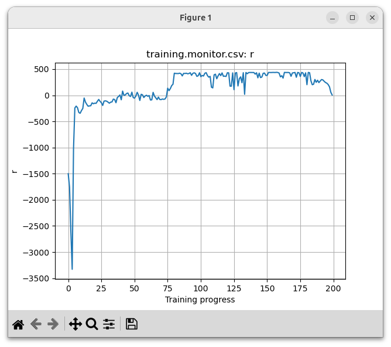
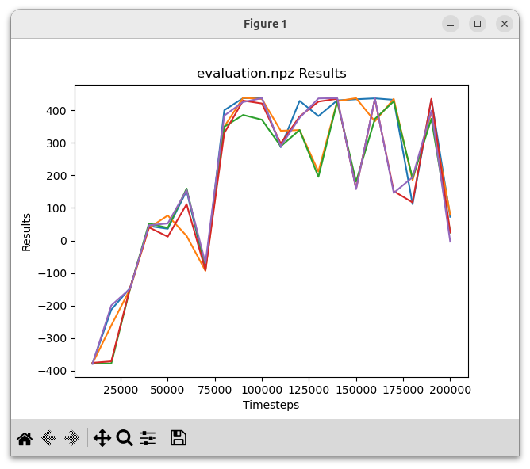

# Reward Analysis #
Below was the reward function that I used
```
    g = 9.81  # gravity
    r = 0.125

    reward =  -0.01* (g - (r * alpha_dot**2) / 2 - g * np.cos(alpha))**2

    reward += 0.001 * (-0.10 * theta**2 - 0.01 * theta_dot**2 - 0.1* alpha**2 - 0.01 * alpha_dot**2 - 0.01 * action**2)

    reward += upright(state) * 0.5  # bonus for being upright
```

And it has 3 main components, the first being the most important in my opinion. Initially I tried to craft the reward based on the negative distance to my goal and I started off with basically only:

```
    reward += 0.001 * (-0.10 * theta**2 - 0.01 * theta_dot**2 - 0.1* alpha**2 - 0.01 * alpha_dot**2 - 0.01 * action**2)
    reward += upright(state) * 0.5  # bonus for being upright
```

This reward has a local maximum whenever the beam is balanced, but somehow it just did not work, even after tuning the gains. All the state variables are motivated to go to 0, the position and the velocity. One could argue that the `theta^2` term is not that necessary.

I realized that the reward function could be improved upon because it is not actually a good metric for how close the system is to the goal. Regardless of what alpha is, alpha_dot is motivated to be 0. This is counter-productive when the beam is hanging downwards. In that case it is better to have a non-zero alpha_dot than a 0 alpha_dot. So I introduced the first term:

```
    reward =  -0.01* (g - (r * alpha_dot**2) / 2 - g * np.cos(alpha))**2
```
This part of the reward was inspired by the concept of energy conservation. The reward should somewhat resemble the "distance" to the goal, and one good scalar metric would be how much energy is in the system at any state compared to the goal state. So the goal is that:

$E_{system} = E_{goal}$

Therefore $E_{system} - E_{goal} = 0$

Reward = - gain * $(E_{system} - E_{goal})^2$

Assuming the zero point for gravitational potential energy is set at alpha = PI/2 and that the pendulum is a concentrated mass at its center.

$E_{system} = 1/2mv^2 + mg*r \cos(\alpha) = 1/2m\dot{\alpha}^2r^2+ mg*r \cos(\alpha) $

$E_{goal} = mgr$
The goal is that the beam points upwards and has no kinetic energy. After some algebraic manipulation we get:

$E_{goal} - E_{system} = r - 1/2*\dot{\alpha}^2r - g\cos(\alpha)$

which corresponds to the first part of the reward function. This part specifically rewards having the correct amount of energy in the system, which means high velocity when the beam is pointed downwards, and no velocity when the beam is pointed upwards. Without this part punishing alpha_dot was global, regardless of the angle the beam was at, which is not a good measure of the distance to the goal.


### What does the return curve represent? What range of values is possible with your reward, and why? ###



The return curve represents the reward to go. It is given in ```env.py``` that ```self.max_steps = round(self.p.episode_seconds/self.p.control_dt)```

and in the reactor_params.yaml we have
```
episode_seconds: 10.0
control_dt: 0.01
```

This means self.max_steps = 10/0.01 = 1000. My maximum reward per stage is 0.5 and 0.5 * 1000 is 500, which is the theoretical maximum reward to go. That reward can only be reached if we start perfectly initially and never deviate from that, which is not the case most of the time, therefore most of the well-learned returns hover slightly above 400.

### How does its shape relate to what the agent learns, for example swing-up first and balancing later? ###
training_monitor.png is especially interesting. It starts off very low, where nothing is learned, then it hovers around 0 for a while. For my reward function, this happens when the total energy in the system is correct, but it has not yet learned to keep it in the upright stable position.For example the beam is just spinning around with slightly too much or too little energy so that it doesn't stay at the optimum. Then later on the return sharply increases after presumably it is able to keep the beam upright consistently.

### Episodes only end early when a speed limit is exceeded. What does the episode length tell you, and how can you use it to monitor training? ###
If the episode length is shorter than 10 seconds it means that a speed limit has been exceeded. If that happens one could increase the cost of a large alpha_dot or theta_dot.